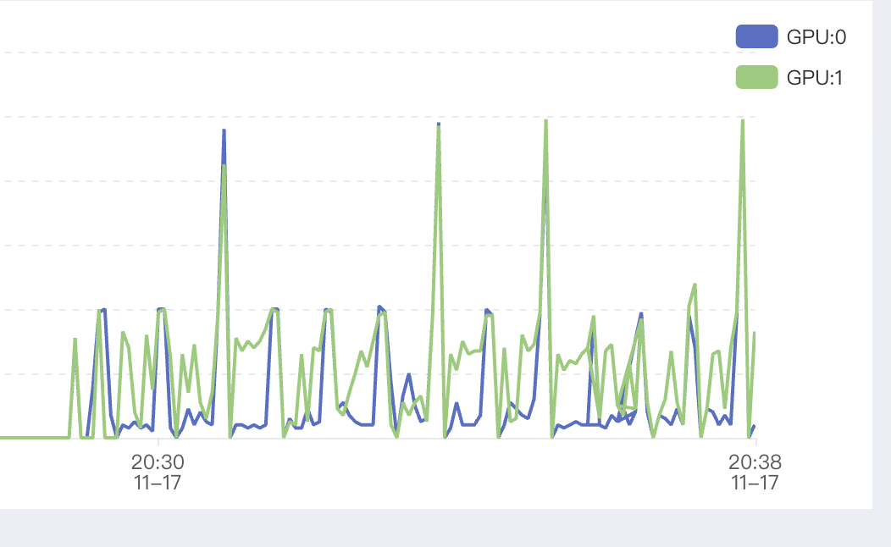
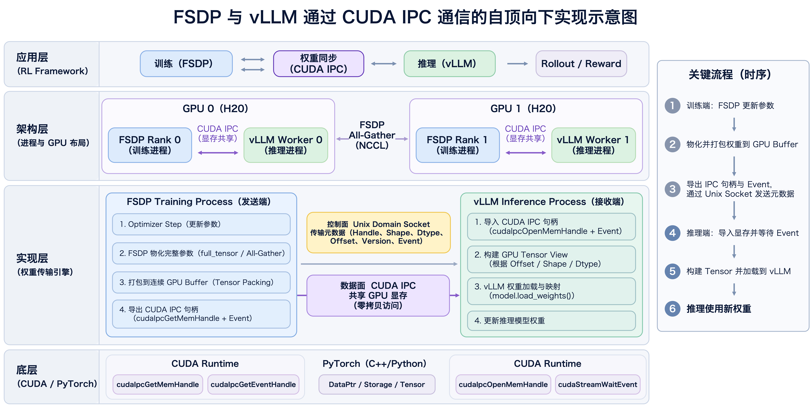

# 遇到的问题
在双卡RTX Pro6000和H20 的RL测试中，单次rollout+训练阶段出现了显著的一段低GPU性能占用，单次训练的时间非常长。

反向传播更新参数后，新参数的更新默认通过CPU发布权重，将新的模型参数分发给vLLM进行下一步推理，IO通信和CPU序列化造成了巨大的通信延时和性能开销。通过 CUDA IPC 可以将 训练进程(FSDP) 和 推理进程(vLLM) 卡内跨进程通信，减少了CPU中转的开销。

| 指标 | `/dev/shm` | CUDA IPC |
|---|---:|---:|
| 权重发布 | 45.49 秒 | **0.71 秒** |
| 整步 | 53.01 秒 | **8.41 秒** |

# CUDA IPC

## vllm 推理侧的 IPC handle
vLLM 提供了五个IPC 相关class

- `IPCTrainerInitInfo`
- `IPCTrainerWeightTransferEngine`
- `IPCWeightTransferEngine`
- `IPCWeightTransferInitInfo`
- `IPCWeightTransferUpdateInfo `

## pytorch IPC handle

