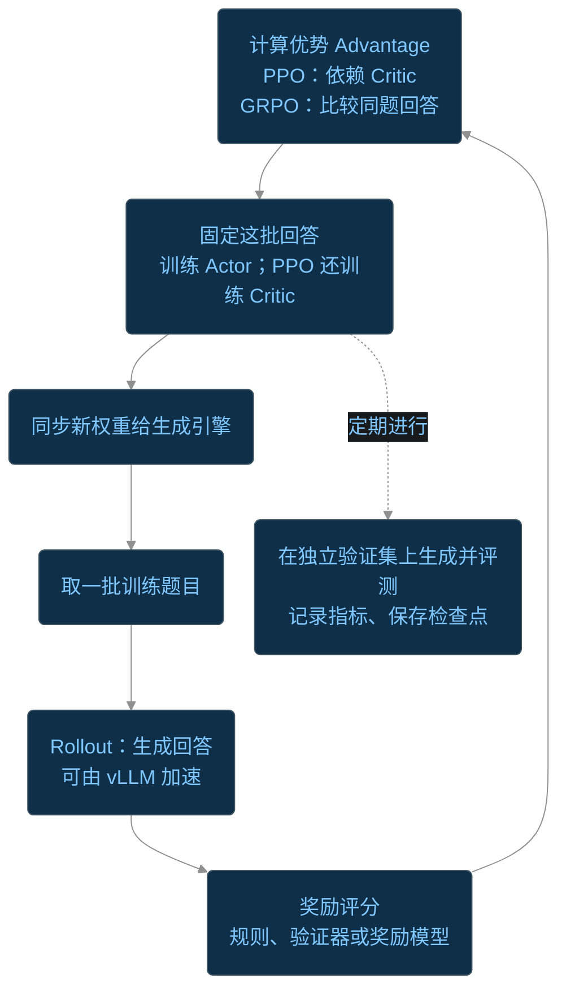

中提及Q函数的更新，一系列如QL、DQN的算法得到的策略是固定的。对于基于策略的强化学习，通过优化策略的本身而非策略的Q value，给定参数 $\theta$ 对策略参数化，并使用神经网络优化 $\theta$
# 策略优化算法

自然策略梯度下降的过程可以概括为：

Actor 通过 Rollout 生成动作与 logprob；Critic 利用 Rollout 奖励学习 Value Function，并辅助计算 Advantage；Actor 将 logprob 与 Advantage 结合计算策略梯度，更新策略参数，随后进入下一轮 Rollout。

## PPO -- Proximal Policy Optimization
我们的优化目标是
$$
\max_{\theta}J(\theta) = \max_\theta E_{\tau \sim \theta}R(\tau) = \max_{\theta}\sum_\tau P(\tau;\theta) R (\tau)
$$

$\tau$ 是agent的交互状态-动作轨迹, 为策略链上每一节状态和动作概率的乘积

$$
P(\tau;\theta) = \prod_{t=0}^T P(s_{t+1}|s_t,a_t)\pi_\theta(a_t|s_t)
$$

目标变为
$$
\max_{\theta}\sum_\tau P(\tau;\theta) R (\tau) = \max_{\theta}\sum_\tau\prod_{t=0}^T P(s_{t+1}|s_t,a_t)\pi_\theta(a_t|s_t)R(\tau)
$$
求导
$$
\begin{aligned}
\nabla_\theta\sum_\tau P(\tau;\theta) R (\tau) &=\sum_{\tau}\nabla_\theta P(\tau;\theta)R(\tau)\\
& = \sum_r R(\tau)P(\tau;\theta) \nabla_\theta \log P(\tau;\theta)\\
& = E_{\tau\sim \pi_\theta}R(\tau) \nabla_\theta \log P(\tau;\theta)\\
& = E_{\tau\sim \pi_\theta} R(\tau)\nabla_\theta\sum_{t=0}^T[\log P(s_{t+1}|s_t,a_t)+\log\pi_\theta(a_t|s_t)]\\
& = E_{\tau\sim \pi_\theta} R(\tau)\nabla_\theta\sum_{t=0}^T \log\pi_\theta(a_t|s_t)
\end{aligned}
$$
也就是一阶条件
$$
\nabla_\theta J(\theta) = E_{\tau\sim \pi_\theta} R(\tau)\nabla_\theta\sum_{t=0}^T \log\pi_\theta(a_t|s_t) = 0
$$
通过策略梯度更新的方式将 $\theta$ 逐步优化到最优的 $\hat\theta$ 上。

$$
\theta \gets \theta + \alpha \nabla_\theta J(\theta)
$$

梯度的样本近似, 取样$m$ 条轨迹, 使用样本均值近似样本期望（这里就涉及到了后文中的Rollout）
$$
\nabla _\theta J(\theta)\simeq \frac{1}{m}\sum_{k=1}^m R(\tau^{(k)})\nabla_\theta \log P(\tau^{(k)};\theta)
$$
根据上面的对数求导展开，并联合每一个样本轨迹的step 联合均值
$$
\begin{aligned}
\hat g= &\frac{1}{m}\sum_{k=1}^m R(\tau^{(k)})\nabla_\theta \sum_{t^{(k)}=1}^{T^{(k)}} \log \pi_\theta(a_{t^{(k)}}|s_{t^{(k)}})\\
\hat g_{step} = & \frac{1}{n}\sum_{k,t} R(\tau^{(k)}) \nabla \log \pi_\theta (a_{t^{(k)}}|s_{t^{(k)}})
\end{aligned}
$$
其中总step 数满足
$$
n = \sum_{k=1}^m T^{(k)}
$$
逐样本的梯度和逐step的梯度之间相差样本的step长度均值
$$
\hat g = \frac{n}{m} \hat g_{step}
$$

### KL 散度和二阶计算优化
基于 评估一次策略下降下的误差
$$
\begin{aligned}
D_{KL}(\pi_\theta \parallel \pi_{\theta+\Delta \theta}) &= \sum_{x\in X}\pi_\theta(x)\log \frac{\pi_\theta(x)}{\pi_{\theta+\Delta\theta}(x)}\\
& = -\sum_{x\in X} \left[\pi_\theta(x) \frac{\partial \pi_\theta(x)}{\pi_\theta(x)\partial \theta }\right]^T \Delta \theta + O(\|\Delta\theta\|^2) \\
& = -\sum_{x\in X} \left[\frac{\partial \pi_\theta (x)}{\partial\theta}\right]^T\Delta \theta + O(\|\Delta\theta\|^2)\\
& = \frac{1}{2}\Delta\theta^T F(\theta)\Delta \theta +o(\|\Delta\theta\|^2)
\end{aligned}
$$

Fisher 信息矩阵保留了KL散度意义下策略间的二阶误差信息，同时说明Forward KL 散度和 Backward KL 散度的 Fisher 矩阵一致性。

根据前文中的策略下降一阶条件，目标优化为
$$
\max_{\Delta \theta} J(\theta +\Delta\theta)\quad D_{KL}(\pi_\theta \parallel \pi_{\theta+\Delta \theta}) < \varepsilon
$$
根据前文的展开
$$
\max_{\Delta \theta} \nabla_\theta J(\theta)^T\Delta \theta\quad \frac{1}{2}\Delta \theta^T F(\theta) \Delta \theta<\varepsilon
$$
松弛化后取一阶条件为0
$$
\begin{aligned}
\frac{\partial}{\partial\Delta\theta} \nabla_\theta J(\theta)^T \Delta \theta -\frac{\lambda }{2}(\Delta\theta^T F(\theta)\Delta \theta-\varepsilon) & = \nabla_\theta J(\theta) -\lambda F(\theta)\Delta \theta = 0
\end{aligned}
$$
更新方向为
$$
\Delta\theta = \frac{1}{\lambda}F^{-1}g=:\alpha F^{-1}g
$$

带回二阶估计中
$$
\varepsilon = \frac{1}{2}(F^{-1}g)^T F(F^{-1}g) = \frac{1}{2}\alpha^2 g^TF^{-1}g
$$

$$
\alpha = \sqrt{\frac{2\varepsilon}{g^TF^{-1}g}}
$$
$$
\Delta\theta = \sqrt{\frac{2\varepsilon}{g^TF^{-1}g}} F^{-1}g
$$

但是Fisher 矩阵的本身构造至少为$O(n^2)$，策略梯度的逆矩阵运算的开销为 $O(n^3)$

共轭梯度法
$$
g = \frac{1}{\lambda}F \Delta \theta: =Fv
$$

### 策略

不同的策略 $\pi_\theta$ 决定了不同的梯度的计算方式。总结而言，RL关心的问题涵盖

| 关键问题 | 具体内容 |
|---|---|
| **任务与目标如何定义** | 状态、动作、奖励、终止条件、折扣因子；最大化什么回报 |
| **策略如何表示** | 使用什么策略分布；是否学习价值函数或环境模型 |
| **如何采样与探索** | 用哪种策略收集数据；如何探索；是否复用旧数据，是否需要重要性采样 |
| **如何评价动作** | 估计 \(V,Q,A\)；怎样把延迟奖励归因到之前的动作，即信用分配 |
| **如何估计梯度** | 用样本近似期望；控制估计的偏差与方差，例如 baseline、优势估计 |
| **如何稳定更新** | 学习率、度量与预条件、KL 约束或惩罚、PPO 概率比裁剪、梯度范数裁剪 |

### 常见的策略
 中计算了，任何策略满足的条件只有对全动作空间的累积为 $1$ 。 对于离散动作空间
$$
\sum_{a\in \mathcal A_s} \pi_\theta(a|s) = 1
$$
连续动作空间
$$
\int_{a\in\mathcal A_s} \pi_\theta(a|s)\,\mathrm{d} a = 1
$$
#### Softmax 策略
Softmax 自然有
$$
\displaystyle \sum_j\frac{e^{x_j}}{\sum e^{x_k}} = 1
$$
可以诱导出离散动作空间的Softmax策略

Softmax 策略定义为
$$
\pi_\theta (s,a) = \dfrac{e^{\phi(s,a)^T\theta}}{\displaystyle \sum_{a'\in\mathcal A_s} e^{\phi(s,a')^T\theta}}
$$

#### 高斯策略

高斯策略是基于高斯分布生成的连续动作空间策略

$$
\pi_\theta(a|s) = \frac{1}{\sqrt{2\pi}\sigma_\theta} e^{-\frac{(a-\mu_\theta)^2}{2\sigma_m^2}}
$$
$$
\mu_\theta = \phi(s,a)^T\theta
$$

#### Diffusion 策略

Diffusion 基于高斯策略通过 Normalizing Flow 生成更加复杂的分布

... To Be Continued

### TRPO
On-policy 的梯度目标是
$$
\max J(\theta) = E_{\tau \sim \pi_\theta}R(\tau) = E_{\tau\sim\pi_\theta} [R(\tau)\nabla_\theta \log \pi_\theta(\tau)]
$$

TRPO 尝试使用上一步冻结的策略 $\pi_{old}$ 的 rollout, 基于IS修正下的代理目标梯度估计**本轮**的策略梯度

{% post_link CS/AI/RL/Markov TD修正}
$$
\nabla_\theta J(\theta) = E_{\tau\sim \pi_{old}}\left[ \frac{\pi_\theta(\tau)}{\pi_{\theta_{old}}(\tau)}A(\tau)\nabla_\theta \log\pi_{\theta}(\tau)\right]
$$

即
$$
\theta_{n+1} = \theta_n + \sqrt{\frac{2\varepsilon}{\hat{g}_n^T\hat{H}_n^{-1}\hat{g}_n}}\hat{H}_n^{-1}\hat{g}_n
$$
这其中的 $\hat{g}$, $\hat{H}$ 表示从 Rollout 的样本轨迹中计算的梯度和Hessian 对实际的梯度的估计量

通过共轭梯度法[@wikipedia_conjugate_gradient_method] 基于普通的梯度和Fisher矩阵进行梯度的优化
$$
(J\to g)\to(F,g)\to v
$$

### PPO Penalty
TRPO 要求
$$
\max_{\Delta \theta} J(\theta +\Delta\theta)\quad D_{KL}(\pi_\theta \parallel \pi_{\theta+\Delta \theta}) < \varepsilon
$$

PPO 通过软约束将KL散度作为惩罚项加入约束的考虑
$$
L = \max_{\Delta \theta} J(\theta+\Delta\theta) - \beta D_{KL}(\pi_\theta\Vert \pi_{\theta+\Delta\theta}) =\max_{\Delta \theta}
\mathbb E[r_t(\theta)\hat A_t]
-\beta D_{\mathrm{KL}}
(\pi_{\theta}\Vert\pi_{\theta+\Delta\theta})
$$

求梯度
$$
\nabla_\theta L = \max_{\Delta\theta}\mathrm{E}[r_t(\theta)\hat A_t \nabla_\theta \log\pi_\theta] - \beta \nabla_\theta D_{\mathrm{KL}}
(\pi_{\theta}\Vert\pi_{\theta+\Delta\theta})
$$
### PPO-Clip

PPO-Clip 则是通过阈值进一步做reward 截断，避免出现极高正向reward 和 极小负向reward

$$
\mathrm{clip}(r,1-\varepsilon,1+\varepsilon) = \begin{dcases}
1-\varepsilon&r<1-\varepsilon \\
r& 1-\varepsilon\leq r\leq 1+\varepsilon\\
1+\varepsilon & r>1+\varepsilon
\end{dcases}
$$

$$
L_{clip} = \mathrm{E}_t \left[\min(r_t\hat A_t, \mathrm{clip}(r_t,1-\varepsilon,1+\varepsilon) )\right]
$$

## GRPO -- Group Relative Policy Optimization

# RL的实践

## Rollout

Rollout 就是基于当前的策略进行一轮采样，并以轨迹 $\tau$ 生成完整的输出序列。因为有关于当前策略梯度的评估无法通过解析计算，需要通过 Rollout 的样本进行蒙特卡洛近似。

通过Rollout 近似估计的策略单步计算有
- 策略梯度估计
- Fisher矩阵估计
- Advantage / Baseline 估计

$$
\nabla_\theta J(\theta) = E_{r\sim \pi_{\theta}}[R(\tau)\nabla_\theta\log\pi_\theta(\tau)]\Longrightarrow \nabla_\theta J(\theta) \simeq  \frac{1}{m}\sum_{k=1}^m R(\tau^{(k)})\nabla_\theta \log\pi_\theta (\tau^{(k)})
$$

由于
$$
E_{\pi\sim \pi_{\theta}} R(\tau) = E_{\tau \sim \pi_{\theta_{old}}}\left[\frac{\pi_\theta}{\pi_{\theta_{old}}}R(\tau)\right]:= L(\theta)
$$
取新旧策略比为
$$
r = \frac{\pi_\theta}{\pi_{\theta_{old}}}
$$
将期望对象变换为了相对于旧策略的期望，这样就能用旧策略的 rollout 轨迹估计当前策略的目标梯度，在策略未大幅偏移时等价于当前策略目标的真实梯度。

$$
\nabla_\theta J(\theta) = E_{\tau\sim\pi_\theta}\left[\sum_t\nabla_\theta \log \pi_\theta(a_t|s_t)\cdot Q^{\pi}(s_t,a_t) \right]
$$

## On-Policy and Off-Policy

On-policy 和 Off-policy是指是否依赖正在优化的策略来产生观测数据。

TRPO/PPO 基于 $\pi_{old}$ rollout的轨迹计算逼近的策略梯度，虽然不等于本轮的策略梯度，但是可以通过IS修正动作差异利用 KL 约束控制策略变化，使得旧策略的状态分布仍能近似代表新策略的状态分布。

典型的Off-Policy 的算法有 DQN/SAC等，通过历史的行为记录训练。

## Critic Networks

Critic Networks 对于当前的策略或者动作进行估计，从而计算更加稳定的策略梯度

$$
\hat{V}^{MC} = \sum_k^{T-1}\gamma^k r_{t+k} \simeq V_\phi(s)
$$

本质上是一个逼近问题，典型的可以通过神经网络优化
- 输入：Rollout 中的状态 \(s_t\)
- 标签：根据奖励构造的 Value Target
- 输出：Critic 对累计奖励的预测 \(V_\phi(s_t)\)
- 优化器：Adam、SGD 等一阶优化器

中的估计
$$
\hat A^\pi(s_t, a_t)\approx r_t + \gamma V^\pi(s_{t+1}) - V^\pi(s_t)
$$

通过Critic Network学习
$$
V_\phi(s)\approx
\mathbb E_{\pi_\theta}
\left[
\sum_{k=0}^{\infty}\gamma^k r_{t+k}
\mid s_t=s
\right]
$$

