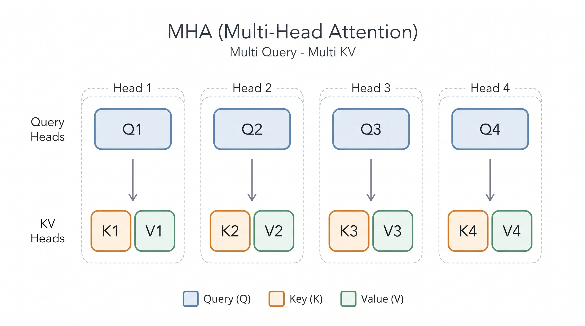
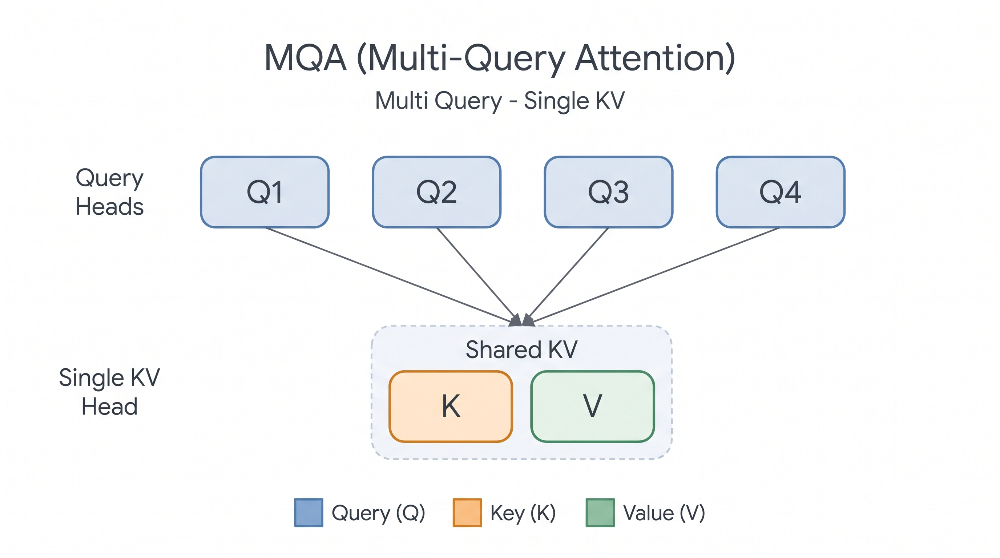
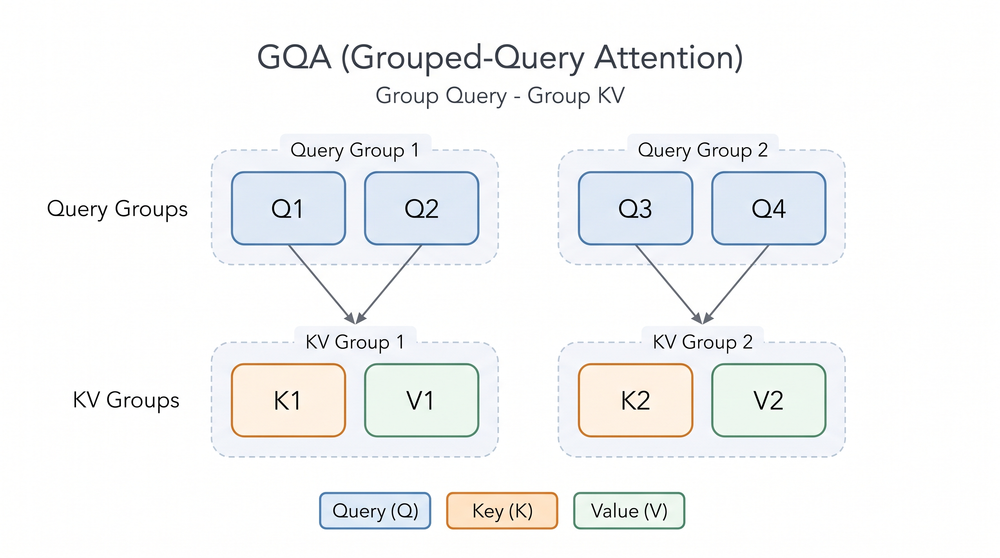

# KVCache

KV Cache 本质是一个空间换时间的策略

$z_i$ 为 token ID，$x_i$ 为该位置的投影输入。Prefill 将 prompt 的 $x_i$ 按行堆叠为 $X$

$$
Q = XW_Q,\qquad K = XW_K,\qquad V = XW_V.
$$

由于注意力是单向的，这保证KV可复用且Q每一个token只使用一次。KV Cache 将输入token的KV缓存

$$
q_t = x_tW_Q,\qquad k_t = x_tW_K,\qquad v_t = x_tW_V.
$$

沿序列维度更新缓存。
$$
K_{\le t} =
\begin{bmatrix}K_{<t}\\ k_t\end{bmatrix}
\in\mathbb R^{t\times d_k},
\qquad
V_{\le t} =
\begin{bmatrix}V_{<t}\\ v_t\end{bmatrix}
\in\mathbb R^{t\times d_v}.
$$

softmax 沿序列维度计算单头注意力输出
$$
o_t =
\underbrace{\mathrm{Softmax}\!\left(
\frac{q_t K_{\le t}^{\top}}{\sqrt{d_k}}
\right)}_{1\times t}
\underbrace{V_{\le t}}_{t\times d_v}
\in\mathbb R^{1\times d_v}.
$$

$h_t$ 为位置 $t$ 的最终隐藏向量，$\ell_t$ 为词表 logits。
$$
\ell_t = h_tW_{\mathrm{vocab}},\qquad
p(z_{t+1}\mid z_{1:t}) = \mathrm{Softmax}(\ell_t)_{z_{t+1}}.
$$

## Prefill and Decode period

Prefill 用 prompt 末位的 logits 选出首个生成 token，下一次 forward 才写入该 token 的 K/V。假如prompt 是 $x = [A,B,C]$

计算KV cache得到
$$
\begin{dcases}
K = [k_A,k_B,k_C]\\
V = [v_A,v_B,v_C]\\
\end{dcases}
$$

## MHA/MQA/GQA 和经典 Cache架构的类比

经典Cache可以分为
- 全相联映射
- r路组相联映射
- 直接映射

以Llama 3.1 8B的模型架构为例子，隐藏维度为$4096$, 由32层Transformer Layer，每层 32个Query构成的。原模型使用GQA，每层共有8个KV头。

每一层的平均参数量为$8B/32 = 250M$(注意B是十进制的，但是实际除去tokenizer和LM Head后层参数量会小于这个值)
$$
\begin{dcases}
\mathrm{Size\,of}(\text{FFN}) = 3\times 4096\times 14336 \approx176M\\
\mathrm{Size\,of}(\text{RMSNorm}) = 2\times 4096 = 8192\\
\mathrm{Size\, of}(W_Q) = 4096\times 4096\approx16.7M\\
\mathrm{Size\, of}(W_K) = 4096\times 1024\approx4.2M\\
\mathrm{Size\, of}(W_V) = 4096\times 1024\approx4.2M\\
\mathrm{Size\, of}(W_O) = 4096\times 4096\approx16.7M
\end{dcases}
$$

在MHA的架构上，多个Query 一对一使用一组KV Cache 计算评分

如果Llama 3.1 使用MHA, 总KV Cache大小为

$$
2\times 32\times 32\times 128\times 4096 \times 2B \approx 2GB
$$

如果Llama 3.1 使用MQA，则全部query共用一个KV Cache，总KV Cache大小为
$$
2\times 32\times1\times128\times 4096\times 2B = 64MB
$$

Llama3.1 实际使用的是8组GQA
$$
2\times 32\times \frac{32}{8} \times 128\times 4096\times 2B = 512MB
$$

# Mooncake 架构[@qin2026mooncakekvcachecentricdisaggregatedarchitecture]

